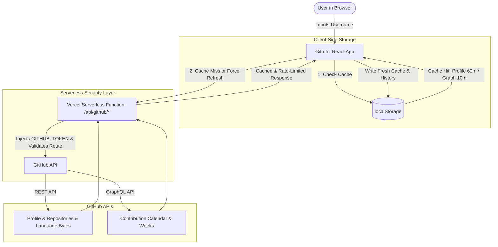

<div align="center">

# GitIntel

**Turn any GitHub username into a clean, comprehensive developer insights dashboard.**

[](https://gitintel-dev.vercel.app)
[](https://github.com/h-edgethedev/GitIntel/issues)
[](https://github.com/h-edgethedev/GitIntel/issues)

<br />


</div>

---

<p align="center">
  
</p>

## Overview

**GitIntel** transforms raw GitHub developer data into clean, actionable visual intelligence. Instead of jumping between tabs and raw commit logs, GitIntel unifies developer metrics into an intuitive dashboard: live profile snapshots, 52-week contribution calendars, velocity and streak analytics, interactive activity trends, and byte-precise multi-language repository breakdowns.

Whether you are scouting potential collaborators, reviewing candidates, benchmarking engineering velocity, or tracking your personal consistency, GitIntel delivers a complete picture in seconds.

---

## Table of Contents

- [Key Features](#key-features)
- [Feature Deep-Dive](#feature-deep-dive)
  - [1. Smart Search with Autocomplete & Avatar Previews](#1-smart-search-with-autocomplete--avatar-previews)
  - [2. Full-Year Contribution Calendar & Streak Analytics](#2-full-year-contribution-calendar--streak-analytics)
  - [3. 52-Week Velocity & Contribution Trends](#3-52-week-velocity--contribution-trends)
  - [4. Repository Intelligence & Byte-Level Language Stacks](#4-repository-intelligence--byte-level-language-stacks)
  - [5. Zero-Leak Serverless API Architecture](#5-zero-leak-serverless-api-architecture)
  - [6. Interactive About Page & First-Time Onboarding](#6-interactive-about-page--first-time-onboarding)
- [Screenshots](#screenshots)
- [Architecture & Data Flow](#architecture--data-flow)
- [Tech Stack](#tech-stack)
- [Getting Started](#getting-started)
  - [Prerequisites](#prerequisites)
  - [Installation](#installation)
  - [Environment Variables](#environment-variables)
  - [Available Scripts](#available-scripts)
- [Project Structure](#project-structure)
- [Caching Strategy](#caching-strategy)
- [Roadmap](#roadmap)
- [Contributing](#contributing)
- [Author & Acknowledgments](#author--acknowledgments)

---

## Key Features

- **Instant Profile Intelligence**: View avatar, bio, location, company, follower counts, following, and total public repos pulled directly from GitHub.
- **52-Week Contribution Heatmap**: Authentic GitHub-styled contribution grid mapped across 365 days with auto-scrolling on mobile displays.
- **Advanced Consistency Metrics**: Real-time computation of Daily Average, Weekly Average, Most Active Day (with date & contribution count), Longest Streak, and Current Streak.
- **Interactive Velocity Charts**: Recharts-powered dual visualizations (Smooth Wave vs Volume Columns) with 12-Week, 26-Week, and 52-Week range filters, momentum indicators, and comparison tooltips.
- **Repository Deep-Dive & Language Breakdown**: Top 12 repositories ranked by stars with byte-level multi-language distribution bars (`LanguageBar`), language percentages, fork indicators, and relative update recency.
- **Smart Searchbar & History**: Autocomplete dropdown with fuzzy search, match highlighting, GitHub avatar previews, keyboard navigation, and storage for your last 20 queries.
- **Secure Serverless Proxy**: Server-side proxy for GitHub REST and GraphQL requests that protects API tokens with strict route whitelisting and rate-limit passthrough.
- **Intelligent Two-Tier Caching**: Client-side `localStorage` caching (60m for profiles & repos, 10m for contributions) with a manual "Fetch Fresh Data" bypass button.
- **Onboarding Flow & About Page**: Built-in `/about` showcase page with interactive mockups and automatic routing for first-time visitors.

---

## Feature Deep-Dive

### 1. Smart Search with Autocomplete & Avatar Previews

GitIntel's search experience is designed for speed and convenience:
- **Instant History Dropdown**: Remembers up to 20 recently analyzed GitHub profiles stored in `localStorage`.
- **Live Match Highlighting**: Dynamically filters suggestions as you type and highlights matched text substrings.
- **Avatar Thumbnails**: Fetches GitHub profile avatars directly in the suggestion menu with graceful fallback icons.
- **Keyboard Friendly**: Full keyboard navigation support (`ArrowUp`, `ArrowDown`, `Enter` to select, `Esc` to close) with visual keycap legends.

### 2. Full-Year Contribution Calendar & Streak Analytics

<p align="center">
  
</p>

Inspect year-round coding habits with complete granularity:
- **Yearly Contribution Total**: Total volume of commits, pull requests, issues, and code reviews recorded over the past 365 days.
- **Mobile-Responsive Auto-Scroll**: Uses an `IntersectionObserver` with an ease-in-out curve to gently scroll the contribution matrix into view on narrow screens.
- **Five Core Consistency KPIs**:
  1. **Daily Average**: Mean contribution volume across all 365 days.
  2. **Weekly Average**: Weekly pace benchmark.
  3. **Most Active Day**: Date of the developer's single most productive coding day along with exact contribution count.
  4. **Longest Streak**: The developer's all-time record of consecutive active days.
  5. **Current Streak**: Active streak count showing immediate momentum.

### 3. 52-Week Velocity & Contribution Trends

<p align="center">
  
</p>

Powered by Recharts, this section visualizes developer cadence, sprints, and cooldown periods:
- **Dual Display Modes**: Toggle between a **Smooth Velocity Wave** (`AreaChart` with gradient fill) and **Volume Columns** (`BarChart`).
- **Flexible Time Horizons**:
  - `12-Week Sprint`: Focus on the last quarter (3 months) for recent velocity.
  - `26-Week Rhythm`: Mid-year (6 months) perspective.
  - `52-Week Annual`: Full-year (12 months) overview.
- **Momentum & Pace Indicators**: Automatically compares the last 4 weeks against the period average (e.g., `▲ +24% recent sprint` or `▼ -10% pace`).
- **Consistency Score**: Percentage of weeks with active commits within the selected timeframe.
- **Benchmark Reference Line**: Visual dotted line denoting average weekly velocity.
- **Custom Rich Tooltips**: Displays week range, total contributions, percentage difference vs average, and the single busiest day of that week.

### 4. Repository Intelligence & Byte-Level Language Stacks

GitIntel breaks down the developer's top 12 repositories sorted by stars:
- **Multi-Language Distribution Bar**: Queries GitHub's `/repos/:owner/:repo/languages` endpoint to calculate exact byte weights and display proportional color-coded segments.
- **Interactive Language Legend**: Chips showing each detected language and its percentage contribution.
- **Repository Metadata**: Star counts with links to stargazers, fork counts, public/fork badges, and descriptions.
- **Relative Timestamps**: Human-readable update times (e.g., *"Updated today"*, *"Updated 3d ago"*, *"Updated 2mo ago"*).

### 5. Zero-Leak Serverless API Architecture

GitIntel implements a secure backend proxy to safeguard API credentials:
- **Server-Side Token Isolation**: All GitHub REST and GraphQL requests flow through a Vercel serverless function (`/api/github/[...path]`). No personal access tokens are bundled into client-side JavaScript.
- **Endpoint Whitelisting**: Strict regex verification allows only GitIntel-required endpoints:
  - `GET users/:username`
  - `GET users/:username/repos`
  - `GET repos/:owner/:repo/languages`
  - `POST graphql` (restricted to the `contributionsCollection` query)
- **Edge Caching & Header Passthrough**: Caches responses with `Cache-Control: public, max-age=120, stale-while-revalidate=300` and passes through GitHub rate limit headers (`x-ratelimit-remaining`, `x-ratelimit-reset`).

### 6. Interactive About Page & First-Time Onboarding

- Accessible via the **About** button in the header and footer, or directly at `/about`.
- Explains the philosophy, feature breakdowns, interactive visual mockups, and technology behind GitIntel.
- Automatically guides first-time visitors (`gitintel_has_visited` local storage flag) to the About walkthrough before their first search.

---

## Architecture & Data Flow



---

## Tech Stack

| Category | Technology | Details |
| :--- | :--- | :--- |
| **Frontend Framework** | [React 19](https://react.dev/) | Built with React 19 and compiled with Babel React Compiler |
| **Build Tool** | [Vite 8](https://vitejs.dev/) | Lightning-fast development server and optimized bundle build |
| **Data Visualization** | [Recharts 3](https://recharts.org/) | Responsive SVG charts (Area and Bar) with custom tooltips |
| **Routing** | [React Router 8](https://reactrouter.com/) | Client-side routing between Dashboard (`/`) and About (`/about`) |
| **HTTP Client** | [Axios](https://axios-http.com/) | API communication configured with `/api/github` baseURL |
| **Serverless Backend** | [Vercel Functions](https://vercel.com/docs/functions) | Node.js proxy securing `GITHUB_TOKEN` and handling GraphQL/REST calls |
| **Analytics** | [@vercel/analytics](https://vercel.com/analytics) | Web performance and usage tracking |
| **Styling** | Vanilla CSS3 | Custom design system with glassmorphism, responsive grids, and CSS variables |

---

## Getting Started

### Prerequisites

- [Node.js](https://nodejs.org/) (version 18 or higher recommended)
- [npm](https://www.npmjs.com/) or [pnpm](https://pnpm.io/)
- A [GitHub Personal Access Token](https://github.com/settings/tokens) (classic or fine-grained token with public read permissions)

### Installation

```bash
# 1. Clone the repository
git clone https://github.com/h-edgethedev/GitIntel.git
cd GitIntel

# 2. Install project dependencies
npm install

# 3. Configure environment variables
cp .env.example .env
```

### Environment Variables

Create a `.env` file in the root directory:

```env
GITHUB_TOKEN=your_github_personal_access_token_here
```

> [!NOTE]
> The `GITHUB_TOKEN` is read on the server side by the serverless function (`/api/github/[...path].js`). It is **never** bundled into the client bundle or exposed in the browser. When deploying to Vercel, configure `GITHUB_TOKEN` under **Project Settings → Environment Variables**.

### Running Locally

```bash
# Start Vite development server
npm run dev
```

The app will start at `http://localhost:5173`.

> [!TIP]
> When testing the serverless proxy locally with full Vercel routing, you can run `vercel dev` if you have the [Vercel CLI](https://vercel.com/docs/cli) installed.

### Available Scripts

| Script | Command | Purpose |
| :--- | :--- | :--- |
| **Dev** | `npm run dev` | Launches the Vite development server with HMR |
| **Build** | `npm run build` | Compiles production assets into `dist/` |
| **Preview** | `npm run preview` | Serves the production build locally for verification |
| **Lint** | `npm run lint` | Runs ESLint to validate code quality and formatting |

---

## Project Structure

```
GitIntel/
├── api/
│   └── github/
│       └── [...path].js           # Vercel serverless proxy (REST + GraphQL)
├── public/
│   ├── favicon.svg                # Application branding icons
│   └── gitintel-logo.png
├── src/
│   ├── api/
│   │   └── githubapi.js           # Axios instance targeting /api/github
│   ├── assets/
│   │   ├── analytics.png          # Documentation and UI screenshots
│   │   ├── home.png
│   │   ├── trends.png
│   │   └── gitintel-logo.png
│   ├── components/
│   │   ├── ContributionData.jsx   # Profile card component
│   │   ├── ContributionsGraph.jsx # Contribution calendar & streak analytics
│   │   ├── LanguageBar.jsx        # Multi-language proportion bar
│   │   ├── RepositoryCard.jsx     # Top repository card with language tags
│   │   ├── Searchbar.jsx          # Searchbar with suggestions & keyboard nav
│   │   └── WeeklyContributionChart.jsx # Velocity trends (Wave / Bar charts)
│   ├── Pages/
│   │   ├── About.jsx              # About & product walkthrough page
│   │   └── About.css              # About page styles
│   ├── services/
│   │   ├── fetchContributions.js  # GraphQL contribution calendar service
│   │   ├── fetchdata.js           # User profile REST service
│   │   ├── fetchLanguageBytes.js  # Repository language breakdown service
│   │   └── fetchRepositories.js   # Top repositories REST service
│   ├── App.jsx                    # Core application layout and state
│   ├── App.css                    # Dashboard stylesheet
│   ├── Routes.jsx                 # Route definitions and first-visit redirection
│   ├── main.jsx                   # Application entry point
│   └── index.css                  # Global resets & font imports
├── index.html                     # HTML root document
├── vercel.json                    # API URL rewrites
├── vite.config.js                 # Vite & React Compiler configuration
└── package.json                   # Dependencies and scripts
```

---

## Caching Strategy

To prevent hitting GitHub rate limits and ensure lightning-fast interactions, GitIntel uses an intelligent caching layer:

| Cache Key | Storage | TTL | Description |
| :--- | :--- | :--- | :--- |
| `github-{username}` | `localStorage` | 60 minutes | User profile bio, avatar, followers, repos count |
| `github-repos-{username}` | `localStorage` | 60 minutes | Top 12 repositories and compiled language bytes |
| `github-contributions-{username}` | `localStorage` | 10 minutes | Contribution calendar matrix and yearly total |
| `username-search-history` | `localStorage` | Persistent | Last 20 searched usernames for autocomplete |

> [!TIP]
> Need real-time numbers? Click the **"Fetch Fresh Data from GitHub API (Bypass Cache)"** button below the search bar to invalidate the cache and fetch live updates.

---

## Roadmap

- [x] Secure Serverless API proxy for GraphQL & REST requests (Zero client-side token exposure)
- [x] Multi-language byte-level breakdown across top repositories with color-coded bars
- [x] Dual-mode charts (Smooth Wave vs Volume Columns) and multi-timeframe filters
- [x] First-time visitor onboarding & comprehensive About page
- [x] Search suggestions autocomplete with avatar previews and keyboard navigation
- [ ] Side-by-side comparison between two developers
- [ ] Shareable profile cards and dynamic Open Graph card generator
- [ ] Dark and light theme toggle
- [ ] Export developer summary report as PDF or image

---

## Contributing

Contributions, feature requests, and improvements are warmly welcome!

1. **Fork** the repository
2. **Create a branch**: `git checkout -b feature/amazing-feature`
3. **Commit your changes**: `git commit -m "feat: add amazing feature"`
4. **Push to your branch**: `git push origin feature/amazing-feature`
5. **Open a Pull Request**

---

## Author & Acknowledgments

**Heritage (H~€DG€)**  
*Building under H~€DG€ Studios*

- GitHub: [@h-edgethedev](https://github.com/h-edgethedev)
- Project Repository: [h-edgethedev/GitIntel](https://github.com/h-edgethedev/GitIntel)

---

<div align="center">

Made with care for open-source developers worldwide.  
If GitIntel provided value to you, please consider giving the repository a **Star** on GitHub.

</div>