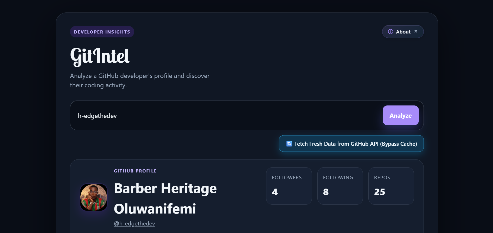
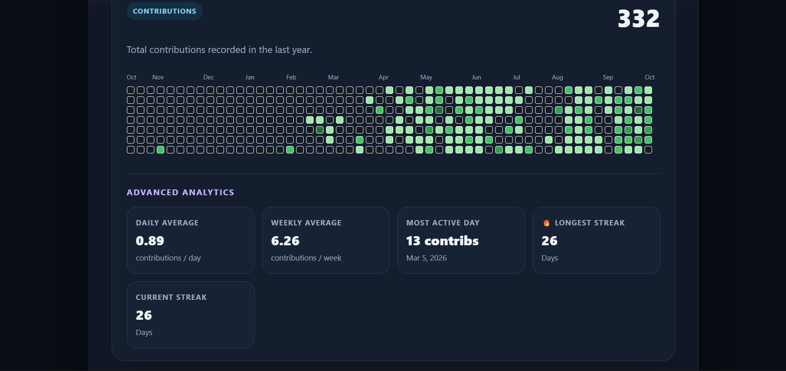
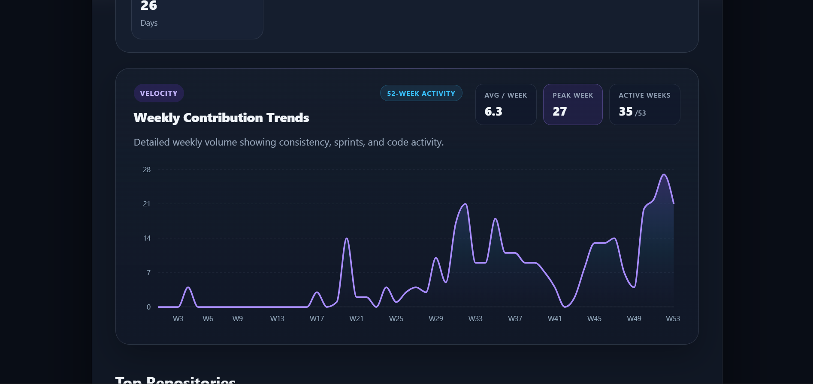

<div align="center">

# GitIntel

**Turn any GitHub username into a clean developer insights dashboard.**

[Live Demo](https://gitintel-dev.vercel.app) · [Report a Bug](https://github.com/h-edgethedev/GitIntel/issues) · [Request a Feature](https://github.com/h-edgethedev/GitIntel/issues)


</div>

---

<p align="center">
  
</p>

## What is GitIntel?

GitIntel is a React web app that takes a GitHub username and turns the raw API data into something you can read at a glance: profile details, a contribution calendar, weekly activity trends, and the developer's top repositories.

It is useful for getting a quick feel for a developer's activity, whether you are checking out a collaborator, reviewing a candidate's profile, or just curious about your own consistency.

## Features

- **Profile overview**: avatar, bio, location, company, followers, following and repo count pulled from the GitHub REST API
- **Contribution graph**: the familiar contribution calendar with a yearly total, fetched through the GitHub GraphQL API
- **Advanced analytics**: daily average, weekly average, most active day, longest streak and current streak, all calculated from the contribution calendar
- **Weekly contribution trends**: a smooth area chart of weekly volume with average per week, peak week and active weeks, so you can spot consistency and sprints
- **Top repositories**: a user's repos ranked by stars
- **Smart caching**: profile data is cached for 1 hour and contribution data for 10 minutes in `localStorage`, which keeps the app fast and protects against GitHub rate limits
- **Force refresh**: a "Fetch Fresh Data" button bypasses the cache when you need live numbers
- **Search history**: your last 20 searched usernames are remembered locally
- **Friendly feedback**: toast notifications and clear error cards for missing users and unavailable data
- **About page**: built-in page explaining the project (via React Router)

## Screenshots

### Contribution graph and advanced analytics

<p align="center">
  
</p>

### Weekly contribution trends

<p align="center">
  
</p>

## Tech Stack

| Area | Tools |
| --- | --- |
| Framework | React with Vite |
| Routing | React Router |
| Data | GitHub REST API and GitHub GraphQL API |
| Analytics | Vercel Analytics |
| Hosting | Vercel |
| Linting | ESLint |

## Getting Started

### Prerequisites

- Node.js 18 or newer
- npm
- A GitHub personal access token (the GraphQL API requires authentication, so the contribution graph will not load without one)

### Installation

```bash
# 1. Clone the repository
git clone https://github.com/h-edgethedev/GitIntel.git
cd GitIntel

# 2. Install dependencies
npm install

# 3. Set up environment variables (see below)
cp .env.example .env

# 4. Start the dev server
npm run dev
```

The app will be running at `http://localhost:5173`.

### Environment Variables

Create a `.env` file in the project root:

```env
VITE_GITHUB_TOKEN=your_github_personal_access_token
```

> **Heads up:** variables prefixed with `VITE_` are bundled into the client-side JavaScript, which means anyone can read them in the browser. For local development with a read-only, no-scope token this is fine. For a public deployment, route GraphQL requests through a serverless function (for example a Vercel API route) so the token stays on the server.

To create a token, go to **GitHub → Settings → Developer settings → Personal access tokens** and generate one. No special scopes are needed for public profile data.

### Available Scripts

| Command | What it does |
| --- | --- |
| `npm run dev` | Starts the Vite dev server with hot reload |
| `npm run build` | Creates a production build in `dist/` |
| `npm run preview` | Serves the production build locally |
| `npm run lint` | Runs ESLint across the project |

## Project Structure

```
GitIntel/
├── public/
├── screenshots/                    # README images
├── src/
│   ├── components/
│   │   ├── ContributionData        # Profile card
│   │   ├── ContributionsGraph      # Contribution calendar
│   │   ├── WeeklyContributionChart # Weekly activity chart
│   │   ├── RepositoryCard          # Single repo card
│   │   └── Searchbar               # Search input + history
│   ├── services/
│   │   ├── fetchdata               # Profile data (REST)
│   │   ├── fetchContributions      # Contribution calendar (GraphQL)
│   │   └── fetchRepositories       # Top repos (REST)
│   ├── App.jsx                     # Main app logic, caching and state
│   └── App.css
├── index.html
├── vite.config.js
└── package.json
```

## How It Works

1. You enter a GitHub username and hit search.
2. GitIntel checks `localStorage` for a fresh cached copy of that user's data.
3. If the cache is missing or expired, it calls the GitHub REST API for the profile and repos, and the GraphQL API for the contribution calendar.
4. Results are rendered as cards and charts, then cached for next time.
5. The username is saved to your local search history.

## Roadmap

- [ ] Move GraphQL calls behind a serverless proxy so no token is exposed in the client
- [ ] Language breakdown across repositories
- [ ] Compare two developers side by side
- [ ] Shareable profile links
- [ ] Dark and light theme toggle

## Contributing

Contributions, issues and ideas are welcome.

1. Fork the repo
2. Create a feature branch: `git checkout -b feature/your-feature`
3. Commit your changes: `git commit -m "Add your feature"`
4. Push the branch: `git push origin feature/your-feature`
5. Open a pull request

## Author

**Heritage (H~€DG€)**, building under H~€DG€ Studios

- GitHub: [@h-edgethedev](https://github.com/h-edgethedev)

---

<div align="center">

If GitIntel helped you out, consider leaving a star on the repo.

</div>